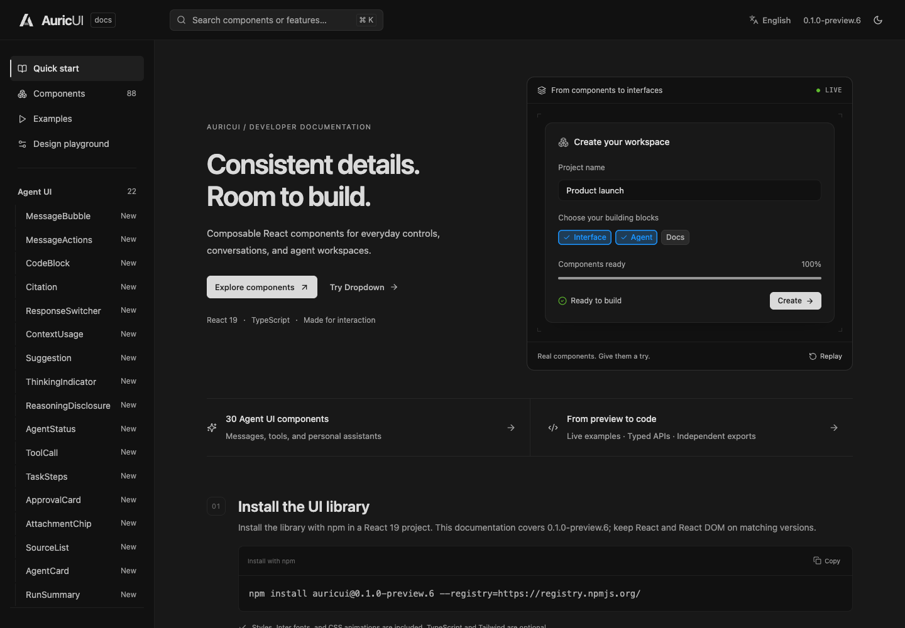

# AuricUI

**English** | [简体中文](./README.zh-CN.md)

**A React component library for AI applications, from everyday interactions to chat and editing workspaces.**

AuricUI brings forms, messages, tool calls, project management, and media editing into a shared visual system. Built around a dark theme with light mode support, it helps you create AI assistants, agent workspaces, and content creation tools.



[Documentation & demos](https://coderclouds.com:8443/#/start) · [Quick start](#quick-start) · [Package entry points](#package-entry-points) · [Run the documentation](#run-the-documentation) · [Contributing](./CONTRIBUTING.md)

Author: [hehuan](https://github.com/Secretmakewomenwomen) · [GitHub](https://github.com/Secretmakewomenwomen/auric-ui)

## Features

- **Everyday controls and AI interactions**: buttons, tables, and dialogs alongside messages, citations, tool execution, approvals, and memory displays.
- **Composable workspaces**: rich text input, model menus, timelines, layers, assets, and inspector panels you can combine for your application.
- **Themes and motion included**: dark and light themes, CSS variables, the Inter font, and transitions. Component styles work without additional Tailwind configuration.
- **Examples backed by real components**: documentation previews and copyable code share the same example sources. Prop information comes from TypeScript, and package consumption is checked during validation.

## Quick start

### 1. Install the component library

In an existing **React 19 + React DOM 19** project, run:

```bash
npm install auricui@next
```

### 2. Install the Skill to build interfaces with your AI agent

AuricUI includes a coding agent Skill with component selection guidance, API lookup tools, theme configuration, service integration guides, and compilable examples. Once installed, describe the page you want and have your agent implement it using the library's actual APIs.

The Skill loads information on demand. Its entry point keeps the essential constraints; the agent searches for components, looks up individual APIs, and loads a specific example or integration guide when needed. API queries prefer the version installed in your project, keeping the full component index and example collection out of the initial context.

Run this from your application project's root:

```bash
npx auricui-skill@latest
```

By default, the Skill is installed in `.agents/skills/auricui` in the current project. To use it across Codex projects, install it globally:

```bash
npx auricui-skill@latest --global
```

Refresh your agent's Skill list or start a new session, then mention `$auricui` in your message. For example:

```text
Use $auricui to build an AI assistant workspace for this project:
a conversation list on the left, chat in the center, and a message input at the bottom.
Support dark and light themes, streaming responses, and tool call status.
Check the installed component version and APIs first, then implement the page.
Connect application requests through callbacks.
```

The Skill installer installs the guides and tools; install the component library separately with the `npm install` command above. For other agents that support `SKILL.md`, use `--dir <skills-parent-directory>` to choose the location. If your tool does not discover Skills automatically, ask it to read `SKILL.md` in the installation directory. To update an existing installation, add `--update` to the original command; the installer backs up the previous version first. See the [Skill guide](./packages/auricui-skill/README.md) for more options.

#### First use: let the agent understand your project

Open your application project in your coding tool and send your request in the conversation. Mention `$auricui` in your message to the agent. For an initial integration, have it inspect the project structure and dependencies before building a small page:

```text
Use $auricui. First inspect this project's framework, React version, and installed AuricUI exports.
Keep the existing router and package manager, and configure global styles and the theme
without mounting duplicate Providers.
Then build an application settings page with a theme switch, notification toggles,
and save feedback.
```

If the agent does not recognize a project-local Skill, tell it: "Read `.agents/skills/auricui/SKILL.md` first, then follow its guidance for this task." For global or custom installations, use the path printed by the installer. The included dependency and API lookup scripts require Python 3 and can be run by the agent as described in the guide.

#### Describe the layout, interactions, and data sources

You do not need to name every component in advance. Explain who the page is for, its main sections, and what should happen when someone interacts with it. Provide existing APIs or data types so the agent can choose suitable components. If the backend is not ready, request local sample data and application callbacks:

```text
Use $auricui to build a task management page.
Place search and status filters at the top, show tasks in a table, and open task details
in a drawer on the right when a row is clicked.
Handle loading, empty, and error states, and make the layout work on narrow screens.
Use local sample data for now. Expose search, save, and delete callbacks
so they can be connected to real APIs later.
```

#### Update an existing page: define the scope and behavior to preserve

The Skill also supports gradual adoption. Share the target files or have the agent locate the page, then describe the business logic to preserve, the visual changes you want, and the allowed scope:

```text
Use $auricui to update the existing user settings page.
Keep the current form fields, validation, API calls, and routing.
Replace the UI components and make the styling consistent.
Use a 6px button radius and subtle focus styles; disable controls while saving
and show the result afterward.
Check which props the installed components support, and compose application-level
solutions for anything they do not provide.
```

#### Keep iterating with requirements you can verify

After the first implementation, refine it with requests such as "make the sidebar narrower," "add an empty state," or "let the drawer close with the keyboard." For bugs, include the steps to reproduce, the actual behavior, and the expected result. For example: "Scrolling to the bottom of the workspace reveals a blank area. Keep the page within the viewport and let each panel scroll internally."

Before finishing, ask the agent to verify the work:

```text
Review these changes using the AuricUI Skill.
Confirm that the page uses public components and props from the installed version,
and that styles and Providers are configured correctly.
Run the project's existing type checks and build. In an available browser,
verify keyboard interaction, both themes, narrow layouts, and loading, empty, and error states.
Report what was verified, which features still use mock data, and anything that could not be checked.
```

### 3. Minimal integration

AuricUI ships ESM and TypeScript declarations and can also be used in JavaScript projects. The `next` npm channel contains preview releases and may lag behind the repository. Your project's lockfile determines the installed version.

Import the styles at your application entry point and mount `AuricUIProvider` once at the root:

```tsx
import { useState } from 'react';
import { AuricUIProvider, CardButton } from 'auricui';
import 'auricui/styles.css';

export default function App() {
  const [theme, setTheme] = useState<'dark' | 'light'>('dark');

  return (
    <AuricUIProvider theme={theme}>
      <main
        style={{
          minHeight: '100vh',
          padding: 24,
          background: 'var(--bg)',
          color: 'var(--text)',
        }}
      >
        <CardButton
          weight="primary"
          onClick={() => setTheme(theme === 'dark' ? 'light' : 'dark')}
        >
          Switch to {theme === 'dark' ? 'light' : 'dark'} theme
        </CardButton>
      </main>
    </AuricUIProvider>
  );
}
```

Set `<html data-theme="dark">` in the initial HTML so the first render matches the default theme. Wrap Chat components in an `.auricui-chat` container. See the [component package guide](./packages/auricui/README.md) for custom colors, portals, and service integration.

## Package entry points

Choose the entry point that fits your use case:

| Entry point | Includes |
| --- | --- |
| `auricui` | Buttons, forms, Table, Drawer, Tree, Tabs, the theme Provider, and other primitives |
| `auricui/agent` | Messages, citations, tool execution, approvals, memories, goals, and briefings |
| `auricui/chat` | Rich text input, Markdown, model menus, and chat components |
| `auricui/studio` | Timelines, layers, assets, projects, and editor components |
| `auricui/demo` | Local browser demo data, mock hosts, and sample assets |
| `auricui/styles.css` | Compiled component styles, fonts, and animations |

Primitive and Agent components connect to your application through props and callbacks. Some composed Chat and Studio components require service adapters supplied by your application for model requests, project persistence, and media processing. Full scenarios in the documentation demonstrate composition using local mock services.

## Run the documentation

The documentation site includes component previews, copyable examples, prop references, and theme configuration. It also provides five complete scenarios: a chat workspace, a professional editor, project management, application settings, and a template and Skill library.

After cloning the repository, run these commands from the root:

```bash
npm ci
npm run build
npm run dev
```

Open **<http://127.0.0.1:5178/#/start>**.

Source development requires Node.js 22.12+, npm, and `tar`; full validation also requires Python 3. Use the Node.js 22 version specified in `.nvmrc`. The first build generates the component library, Skill installer package, and documentation downloads automatically. No npm login or Docker setup is needed for this workflow.

For subsequent development, run `npm run dev` directly. After changing public APIs or documentation examples, run `npm run docs:generate` to refresh the documentation data.

## Development and validation

| Command | Purpose |
| --- | --- |
| `npm run dev` | Start the documentation development server |
| `npm run prepare:docs` | Generate local packages, API documentation, and downloads |
| `npm run pack:lib` | Build and pack the current component library |
| `npm run build` | Build the component library, Skill, and static documentation site |
| `npm run check` | Run component tests, package consumption checks, documentation example checks, and Skill installer checks |

Run `npm run build` and `npm run check` before submitting changes. Validation covers type declarations, ESM imports, SSR, browser builds, and documentation example compilation. UI interactions also need browser verification; see the [contributing guide](./CONTRIBUTING.md) for details.

To try unpublished changes in another project, run `npm run pack:lib`, copy the generated component library tarball from `artifacts/` into that project, and install it with `npm install ./vendor/your-package.tgz`, using the actual filename.

<details>
<summary>Source layout</summary>

| Directory | Contents |
| --- | --- |
| `src/components/primitives/`, `src/agent/` | Primitive and Agent components |
| `src/chat/`, `src/studio/`, `src/engine/` | Chat, editors, and browser algorithms |
| `src/library/`, `src/styles/` | Public entry points, Provider, and styles |
| `src/docs/`, `src/demo/` | Documentation, component examples, and scenario previews |
| `public/demo-film/` | Local demo assets |
| `packages/` | npm package configuration and installer source |
| `skills/auricui/` | Skill guides, examples, tools, and upstream reference snapshots |
| `scripts/` | Build, validation, and release scripts |

Build outputs in `dist/`, `artifacts/`, and other generated directories are created by scripts and are not committed to Git.

</details>

## Deployment and releases

The documentation site is built into `dist/`. Use the repository's [Dockerfile](./Dockerfile) to create a static site image.

For the Mac publishing script, copy the [configuration template](./.env.publish.example) to `.env.publish.local` once. Set `DOCS_IMAGE` to your image repository without a tag and select your configured Docker builder:

```bash
cp .env.publish.example .env.publish.local
# Edit .env.publish.local and set the actual DOCS_IMAGE
bash scripts/publish-mac.sh --check       # Check local configuration, Docker, and the builder
bash scripts/publish-mac.sh               # Build and publish the documentation image
# To also increment and publish the library and Skill versions:
bash scripts/publish-mac.sh --release all
```

The local configuration is ignored by Git and loaded automatically; environment variables override its values, so a new terminal does not require another `export`. `--check` does not build, increment versions, push, or verify remote publishing permissions. Configure npm / registry authentication and builder certificate trust before publishing. If npm publication succeeds but the image step fails, retry without `--release`. Updating the server still requires pulling the image and recreating its container.

<details>
<summary>Maintainers: publish npm packages</summary>

After updating the guides and examples in `skills/auricui/`, use the Skill maintenance workflow:

```bash
# Sync the component index and examples, build packages and docs, and run all checks
bash scripts/maintain-skill.sh

# After validation, bump the Skill version, publish to npm, and update the local Codex Skill
bash scripts/maintain-skill.sh --publish --install-global
```

For local use only, pass `--install-global` without `--publish`. The script does not write missing component tutorials automatically. See the [Skill maintenance workflow](./CONTRIBUTING.md#skill-维护流程) for options and failure recovery.

Component library and combined release commands:

```bash
npm run release -- --dry-run # Validate the library release without uploading
npm run release             # Bump the version and publish the component library
npm run release:skill       # Bump the version and publish the Skill
npm run release:all         # Publish both packages
```

Run `npm run prepare:docs` before publishing the Skill on its own. Publishing requires the appropriate npm permissions. Library previews use the `next` tag; the Skill uses `latest`. Regular builds and CI generate artifacts and run validation.

</details>

## Contributing

Bug reports, documentation and accessibility improvements, and component fixes are welcome. Read the [contributing guide](./CONTRIBUTING.md) for the development workflow, validation requirements, and contribution scope. The contributing guide and detailed package guides are currently in Chinese.

## License and acknowledgments

AuricUI is licensed under the [MIT License](./LICENSE). Parts of the Chat and Studio UI and browser algorithms come from OpenFilm and retain its [original MIT license](./OPENFILM-LICENSE). Thanks to OpenFilm and the other open source projects that make this work possible.

See [Third-party notices](./THIRD-PARTY-NOTICES.md) for font, provider icon, and dependency attribution and licenses.
