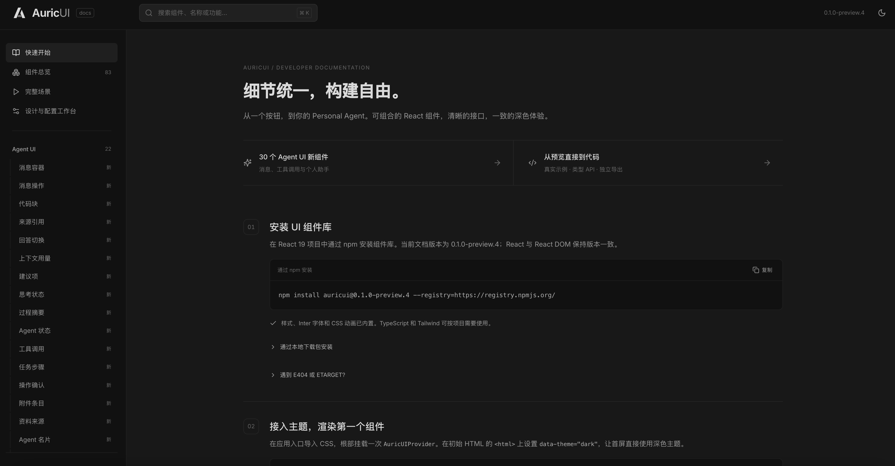

# AuricUI

**面向 AI 应用的 React 组件库，从基础交互到聊天与编辑工作台。**

AuricUI 将表单、消息、工具调用、项目管理和媒体编辑组件放在统一的视觉系统中。以深色界面为起点，支持浅色主题，帮助你搭建 AI 助手、Agent 工作台和内容创作工具。



[在线文档与演示](https://coderclouds.com:8443/) · [快速开始](#快速开始) · [组件入口](#组件入口) · [运行文档](#运行文档) · [参与贡献](./CONTRIBUTING.md)

## 特性

- **覆盖日常交互与 AI 场景**：从按钮、表格和弹窗，到消息、引用、工具执行、操作确认与记忆展示。
- **支持复杂工作台**：提供富文本输入、模型菜单、时间轴、图层、素材和属性面板，可按业务需要组合。
- **主题与动效随包提供**：深浅主题、CSS 变量、Inter 字体和过渡动画，无需额外配置 Tailwind 即可使用组件样式。
- **示例与实际组件一致**：文档中的预览和可复制代码共用示例源，属性信息从 TypeScript 提取，并通过包消费检查。

## 快速开始

在已有 **React 19 + React DOM 19** 项目中安装：

```bash
npm install auricui@next
```

AuricUI 提供 ESM 和 TypeScript 类型声明，也可在 JavaScript 项目中使用。`next` 为 npm 预览渠道，可能落后于仓库源码；安装版本以项目锁文件为准。

在应用入口导入样式，并在根部挂载一次 `AuricUIProvider`：

```tsx
import { useState } from 'react';
import { AuricUIProvider, CardButton } from 'auricui';
import 'auricui/styles.css';

export default function App() {
  const [theme, setTheme] = useState<'dark' | 'light'>('dark');

  return (
    <AuricUIProvider theme={theme}>
      <main
        style={{
          minHeight: '100vh',
          padding: 24,
          background: 'var(--bg)',
          color: 'var(--text)',
        }}
      >
        <CardButton
          weight="primary"
          onClick={() => setTheme(theme === 'dark' ? 'light' : 'dark')}
        >
          切换到{theme === 'dark' ? '浅色' : '深色'}主题
        </CardButton>
      </main>
    </AuricUIProvider>
  );
}
```

在初始 HTML 中设置 `<html data-theme="dark">`，让首屏与默认主题保持一致。使用 Chat 组件时，将对应内容放入 `.auricui-chat` 容器。自定义配色、Portal 和服务接入说明见 [组件包文档](./packages/auricui/README.md)。

## 组件入口

按使用场景选择入口：

| 入口 | 提供的能力 |
| --- | --- |
| `auricui` | 按钮、表单、Table、Drawer、Tree、Tabs、主题 Provider 等基础组件 |
| `auricui/agent` | 消息、引用、工具执行、操作确认、记忆、目标和简报 |
| `auricui/chat` | 富文本输入、Markdown、模型菜单和聊天组件 |
| `auricui/studio` | 时间轴、图层、素材、项目和编辑器组件 |
| `auricui/demo` | 浏览器内的本地演示数据、模拟宿主与素材 |
| `auricui/styles.css` | 编译好的组件样式、字体与动画 |

基础组件与 Agent 组件通过 props 和回调连接业务。部分 Chat / Studio 组合组件需要配置服务适配器，由应用提供模型调用、项目持久化和媒体处理等能力。文档中的完整场景用于展示组合效果，这些服务行为使用本地模拟。

## 运行文档

文档站提供组件预览、可复制示例、属性说明和主题配置，以及聊天工作台、专业编辑器、项目管理、应用设置、模板与技能库五个完整场景。

克隆仓库后，在根目录执行：

```bash
npm ci
npm run build
npm run dev
```

打开 **<http://127.0.0.1:5178/#/start>**。

源码开发需要 Node.js 22.12+、npm 和 `tar`；完整验证还需要 Python 3。推荐使用 `.nvmrc` 指定的 Node.js 22。首次构建会自动生成组件库、Skill 安装包及文档下载资源，无需 npm 登录或 Docker。

后续开发可直接运行 `npm run dev`。修改公开 API 或文档示例后，执行 `npm run docs:generate` 更新文档数据。

## 开发与验证

| 命令 | 用途 |
| --- | --- |
| `npm run dev` | 启动文档开发服务器 |
| `npm run prepare:docs` | 生成本地安装包、API 文档和下载资源 |
| `npm run pack:lib` | 构建并打包当前组件库 |
| `npm run build` | 构建组件库、Skill 与静态文档站 |
| `npm run check` | 执行组件测试、包消费、文档示例和 Skill 安装器检查 |

提交前执行 `npm run build` 和 `npm run check`。检查覆盖类型声明、ESM 导入、SSR、浏览器构建与文档示例编译；界面交互还需在浏览器中验证，具体要求见 [贡献指南](./CONTRIBUTING.md)。

需要在其他项目中试用尚未发布的修改时，运行 `npm run pack:lib`，将 `artifacts/` 中生成的组件库 tgz 复制到目标项目，再通过 `npm install ./vendor/实际文件名.tgz` 安装。

<details>
<summary>源码目录</summary>

| 目录 | 内容 |
| --- | --- |
| `src/components/primitives/`、`src/agent/` | 基础与 Agent 组件 |
| `src/chat/`、`src/studio/`、`src/engine/` | 聊天、编辑器与浏览器算法 |
| `src/library/`、`src/styles/` | 公开入口、Provider 与样式 |
| `src/docs/`、`src/demo/` | 文档、组件示例和场景预览 |
| `public/demo-film/` | 本地演示素材 |
| `packages/` | npm 包配置与安装器源码 |
| `skills/auricui/` | Skill 指南、示例、工具与上游参考快照 |
| `scripts/` | 构建、检查与发布脚本 |

构建产物位于 `dist/`、`artifacts/` 等目录，由脚本生成，不提交到 Git。

</details>

## 部署与发布

文档站构建产物位于 `dist/`，可使用仓库中的 [Dockerfile](./Dockerfile) 制作静态站点镜像。镜像构建、推送与服务器更新步骤见 [部署说明](./deploy/README.md)。

<details>
<summary>维护者：发布 npm 包</summary>

```bash
npm run release -- --dry-run # 校验组件库发布流程，不上传
npm run release             # 递增版本并发布组件库
npm run release:skill       # 递增版本并发布 Skill
npm run release:all         # 发布两者
```

单独发布 Skill 前先执行 `npm run prepare:docs`。实际发布需要对应的 npm 权限；组件库预览版本使用 `next` 标签，Skill 使用 `latest` 标签。日常构建和 CI 只生成产物并运行检查。

</details>

## 参与贡献

欢迎反馈使用问题、改进文档与可访问性，或提交组件修复。开始前请阅读 [贡献指南](./CONTRIBUTING.md)，了解开发流程、验证要求和提交范围。

## 许可与致谢

AuricUI 采用 [MIT License](./LICENSE)。部分 Chat / Studio UI 与浏览器算法来自 OpenFilm，保留其 [原始 MIT 许可证](./OPENFILM-LICENSE)。感谢 OpenFilm 及相关开源项目的贡献。

字体、服务商图标及其他依赖的来源和许可见 [第三方声明](./THIRD-PARTY-NOTICES.md)。
